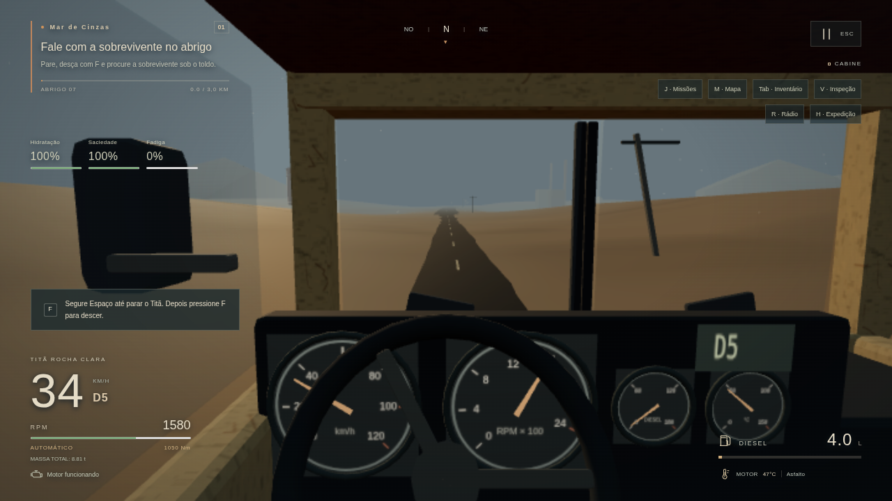

# Reformulação realista — Fase 1: condução (0.5.0)

Entrega de 29/10/2026, sobre o projeto existente 0.4.0. Código e histórico: https://github.com/renataaap/2047.

O pedido novo substitui a direção estilizada pelo realismo e define outro roteiro. Esta entrega cobre a **Fase 1 de diagnóstico/condução**. O continente e os sistemas já operantes foram preservados. A reforma gráfica com Poly Haven é a próxima fase.

## 1. Resumo das melhorias

- Motor diesel com curva de torque por RPM, marcha lenta, limite de rotação, resposta do pedal, potência e consumo derivados da simulação. O comando do acelerador é lido imediatamente; massa, transmissão e tomada de carga explicam a partida progressiva.
- Oito marchas de avanço, neutro, ré, diferencial e eficiência, troca automática com interrupção breve de torque e histerese. S freia em avanço e só engata R depois da parada sustentada. W protege a saída de R; em N rolando para a frente, seleciona uma relação compatível com a velocidade.
- Chassi de 8.800 kg e Semente de 2.200 kg, além de inventário do compartimento e diesel. A massa/inércia e o centro de massa são atualizados no corpo Rapier; a carga deixou de ser um multiplicador artificial de força/consumo.
- Resistência ao rolamento por piso, arrasto aerodinâmico, limite de tração, freio de serviço e freio de motor. Forças são integradas por tempo; a API de freio recebe o impulso correspondente por passo. Gravidade, rampas e colisões continuam no Rapier.
- Direção com limite por velocidade/aceleração lateral, retorno progressivo e ângulos de Ackermann nas rodas dianteiras. Suspensão com seis raycasts, parâmetros ajustados à massa e ao desgaste, mantendo resposta a terreno físico.
- Câmera interna presa ao banco, com olhar local suave; acompanhamento com retorno ao rumo e órbita livre independente da orientação do veículo. Câmeras externas usam varredura de esfera contra colisores fixos, inclusive após interpolar a posição. Distância externa, resposta da direção e movimento da cabine são configuráveis e persistem no navegador.
- Cabine oca com piso/paredes e instrumentos tridimensionais funcionais: velocímetro, conta-giros, combustível, temperatura e marcha. Volante com raios animado pelo esterçamento real e movimento secundário da cabine dirigido pela dinâmica. O HUD ganhou RPM, marcha real, massa e indicação de troca/estacionamento/freio de motor.
- Áudio procedural agora acompanha RPM, carga e mudanças de marcha, com transientes de partida/desligamento/troca. Não foram usados sons proprietários.
- Passo fixo 1/60 s preservado; ordem controlador → passo físico → leitura/interpolação, validação de deltas, contadores de passos/tempo descartado e pausa ao ocultar a aba. Listeners novos têm remoção no dispose.

Novo jogo começa ao volante, em **N e com motor desligado**. E liga; W engata avanço e acelera. Essa alteração segue a experiência de partida pedida. Carregar saves antigos preserva o estado do motor salvo; a caixa é reconstruída em N porque a partida sempre é carregada parada, como antes.

## 2. Arquivos modificados

| Módulo | Mudança principal |
| --- | --- |
| src/data/truck-tuning.js | Parâmetros SI, curva, relações, freios, direção, suspensão e pisos |
| src/game/vehicle/Engine.js | RPM, torque e taxa de consumo |
| src/game/vehicle/AutomaticTransmission.js | Engates, relações, segurança e trocas |
| src/game/vehicle/Powertrain.js | Integração motor/caixa, forças, freio de motor e telemetria |
| src/game/physics/VehiclePhysics.js | Massa/inércia, rodas, forças, freios e direção Rapier |
| src/game/vehicle/model.js e Instruments.js | Cabine oca, instrumentos, volante e movimento secundário |
| src/game/render/Cameras.js e cameraCollision.js | Três câmeras, banco e varredura de volume |
| src/game/core/Game.js e FixedLoop.js | Integração, ordem de passos, contadores e cold start |
| src/game/audio/EngineAudio.js | Áudio por RPM/estado de troca |
| src/game/input/Input.js e persistence/settings.js | Pausa por visibilidade e novos ajustes |
| src/components/hud e menus/Panel.js | Leituras reais e configurações de condução |
| src/game/survival/resources.js e missions/campaign.js | Consumo/carga térmica a partir do motor |
| scripts/benchmark-drive.js | Benchmark reproduzível antes/depois e por ritmo de frames |
| tests/unit/drivetrain.test.js e cameras.test.js | Motor, caixa, forças, carga, suspensão, tempo e câmeras |
| tests/e2e/driving.spec.js | Fluxo real de condução, cabine, áudio, ré, câmera e ajustes |

README, STATUS, DECISOES, CHECKLIST_MANUAL, ASSETS_PENDENTES, COMO_ATUALIZAR e docs/REFORMULACAO_REALISTA foram atualizados. Testes/evidências anteriores foram renovados sem apagar as tags históricas. Etapas verificadas: c72ea69 (núcleo físico) e 4dfda30 (integração/cabine/regressões); documentação no commit seguinte.

## 3. Assets instalados

**Nenhum asset externo instalado nesta fase.** Os novos mostradores usam geometrias e texturas Canvas originais. O áudio permanece sintetizado por Web Audio. Não há arquivos Poly Haven novos nem alegação de instalação de PBR real.

A modelagem externa/texturas/cenário ainda têm a primeira passagem procedural existente. A cabine melhorou para viabilizar instrumentos e condução, sem ser anunciada como o caminhão final realista. A Fase 2 deve verificar IDs, baixar os mapas reais, gerar manifesto/créditos e aplicar materiais locais.

## 4. Sistemas efetivamente funcionais

Motor, caixa automática, ré segura, freios, massa física, resistências por terreno, suspensão, esterçamento, câmeras, instrumentos/HUD e atualização de áudio estão conectados ao veículo. Não há adição de velocidade fixa por frame para dirigir; alterações diretas de posição/velocidade permanecem restritas a carregamento, resgate, saída segura e diagnóstico, como na base anterior.

Os sistemas existentes continuam funcionando: exploração F, coleta, inventário/transferência, consumo, reparos, trocas, NPCs/missões, planejamento, transporte de Sementes, sete ancoragens, restauração e save/load. API/libSQL e schemaVersion 3 foram preservados; saves 1 e 2 continuam aceitos/migrados pela base existente. RPM/marcha são derivados, sem exigir migração destrutiva do banco.

## 5. Testes executados e resultados

```text
npm test
Test Files 9 passed (9)
Tests 74 passed (74)

NEXT_TELEMETRY_DISABLED=1 npm run build
Compiled successfully in 853ms
Generating static pages (10/10)

PLAYWRIGHT_CHROMIUM_EXECUTABLE=/usr/bin/chromium npm run test:e2e
11 passed (4.1m)

node scripts/benchmark-drive.js --output evidence/reformulation-1/driving-0.5.0.json
7 cenários medidos com Rapier WASM
```

Logs reais em `evidence/reformulation-1/unit-tests.log`, `build.log` e `e2e.log`. A compilação cobre as dez rotas anteriores; não foram adicionadas dependências.

**Lógica/física:** curva/limitador, resposta do pedal, engate seguro, seleção de relação ao sair de N, trocas/histerese, massa/inércia e desempenho carregado, subida e pisos, retorno da direção, frenagem com carga, freio de motor, estacionamento carregado em rampa de 10%, suspensão sobre buraco trimesh real, esfera de câmera/parede/borda, banco sem atraso e consistência temporal.

**Tempo:** 15/30/60/120 FPS simulados executam 720 passos em 12 s e produzem o mesmo percurso no benchmark. A frenagem também foi comparada entre 60 e 120 passos físicos por segundo. O passo fixo já existia na base e foi preservado; os novos testes e contadores comprovam sua continuidade, não uma taxa de renderização de GPU que o ambiente não oferece.

**Navegador:** partida fria (W sem motor não gera tração), E/RPM/áudio, cabine/mostradores reais, avanço/trocas, S/frenagem, estacionamento/F, caminhada/retorno, R, câmera com obstáculos e persistência dos ajustes. A suíte também verifica o hotfix de saída, três câmeras, ignição/luzes/pausa, API/cookies/isolamento/CRUD, primeira entrega, sobrevivência/exploração/comércio, migração, Cofres 2–7, missões, clima e recarga integral. Erros de console no fluxo de condução: [].

Benchmark final em piso plano com 100 L e inventário de teste vazio:

| Cenário / 12 s | Massa física | Velocidade |
| --- | ---: | ---: |
| Vazio | 8883.5 kg | 61.94 km/h |
| Semente carregada | 11083.5 kg | 55.70 km/h |
| Subida de aproximadamente 6% | 8883.5 kg | 49.12 km/h |
| Ré | 8883.5 kg | 10.69 km/h |

A referência 0.4.0 mantinha cerca de 6.800 kg com e sem carga e não tinha RPM/marchas. Dados anteriores em baseline-0.4.0.json; dados atuais em driving-0.5.0.json. Os parâmetros são autoriais e ajustáveis, sem alegar calibração com um caminhão real ou equivalência ao ETS2.

No aceite de navegador a 1280×720/Médio: 44.20 km/h após W por 8 s, consumo de diesel real, 140 draw calls e 74252 triângulos. FPS médio medido: **3.25 em SwiftShader**, renderização por software. Os limites geométricos passaram; 60 FPS em GPU real não foram verificados. No fluxo novo em preset Baixo, a cabine apresentou instrumentos/motor e simulação sem tempo descartado no trecho amostrado, conforme driving-browser.json.

## 6. Capturas reais do jogo



Outras capturas: [motor desligado](evidence/reformulation-1/cold-start.png), [marcha lenta](evidence/reformulation-1/cab-idle.png), [ré](evidence/reformulation-1/reverse.png), [câmera/obstáculo](evidence/reformulation-1/camera-collision.png), [configurações](evidence/reformulation-1/driving-settings.png) e [fora do Titã](evidence/reformulation-1/outside-truck.png). Todas saíram do Playwright/renderer do projeto. O cenário mostrado ainda aguarda a reforma PBR da próxima fase.

## 7. Problemas encontrados e tratamento

- A base aplicava força fixa e simulava carga com fatores de potência/combustível. Isso foi substituído por motor/caixa e massa física real.
- Suavizar a posição da câmera interna em coordenadas globais deixava o banco para trás. Agora ela acompanha a cabine; o olhar local e a transição são suavizados.
- O bloco inferior sólido da cabine escondia parte dos instrumentos. Foi substituído por piso/paredes, e o mostrador de marcha foi posicionado fora da oclusão do volante.
- A cauda do filtro do acelerador mantinha tração no início da desaceleração. O corte de tração ao soltar o pedal permite freio de motor coerente.
- S não pode inverter o sentido enquanto o caminhão avança. Há limite de velocidade e espera de engate; W também protege a passagem de R para D. N em avanço seleciona uma relação compatível, sem exigir parada desnecessária no mesmo sentido.
- O script inicial do teste de ajustes sobrescrevia localStorage ao recarregar; foi corrigido para inicializar somente um perfil vazio. A persistência real passou na execução final.

## 8. Problemas existentes e funcionalidades pendentes

- Materiais reais Poly Haven/PBR, mistura de terreno, novos segmentos/estradas físicas, exterior final do Titã, HDRI/ciclo solar e reforma ambiental **não foram implementados nesta Fase 1**. Fazem parte da Fase 2 do roteiro vigente.
- Sensação do pedal/freio/direção, conforto da câmera, equilíbrio dos parâmetros, áudio percebido, desempenho em GPU e Windows real seguem **não verificados** e estão no CHECKLIST_MANUAL. Headless confirma funcionamento, não uma avaliação humana de realismo.
- O áudio é procedural; não contém gravações de caminhão. Retrovisores refletivos, remapeamento completo de teclas, gamepad e transmissão manual continuam pendentes.
- A colisão da câmera cobre os colisores fixos existentes; detalhes decorativos sem colisor e futuros veículos dinâmicos exigem tratamento próprio. A exploração a pé e seus colisores foram preservados.
- A curva/transmissão/resistências constituem uma simulação acessível simplificada. Há conversão de torque e forças, mas não uma simulação completa de pneus, embreagem torsional ou pneumática de freios.
- A travessia humana longa precisa reavaliar a economia após a mudança de consumo. Os testes preservaram os ciclos de recursos/entregas/save/load; não substituem essa avaliação.
- Não houve deploy/Turso remoto. O iniciador Windows continua sem teste em Windows real. GitHub mantém projeto/histórico, não sincroniza partidas entre aparelhos.

## 9. Próxima etapa técnica e execução

A próxima etapa é a **Fase 2 da reformulação gráfica**, conforme docs/REFORMULACAO_REALISTA.md: downloader Node idempotente pela API oficial, validação dos oito IDs, seleção 2K/4K, mapas PBR corretos, manifesto/créditos, cache local e integração. Depois, terreno/estradas, iluminação/ambiente e modelagem do Titã com realismo coerente. Nenhum material deve ser anunciado como instalado se seu download falhar.

No Windows, feche o terminal antigo; obtenha a versão pelo GitHub, preserve banco/cookies conforme COMO_ATUALIZAR e abra INICIAR_JOGO.bat. Confira **0.5.0**. E liga; W acelera; S freia/engata ré após parar; segure Espaço até pressionar F para descer.

Manual: npm ci, npm run db:migrate, npm run dev; abrir http://localhost:3000 no computador que executa o servidor. No celular, retome esta conversa e o GitHub com as mesmas contas, conforme CONTINUAR_NO_CELULAR.md.

APIs oficiais consultadas: [Rapier veículo/rodas](https://rapier.rs/javascript3d/classes/DynamicRayCastVehicleController.html), [massa/inércia](https://rapier.rs/javascript3d/classes/RigidBody.html), [World/shape casts](https://rapier.rs/javascript3d/classes/World.html) e [Three.js câmera](https://threejs.org/docs/pages/PerspectiveCamera.html). As assinaturas foram conferidas também nos tipos oficiais instalados do Rapier 0.21.0; Next/Three permanecem nas versões do lockfile.
